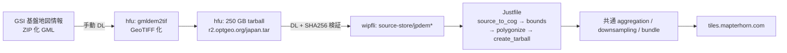
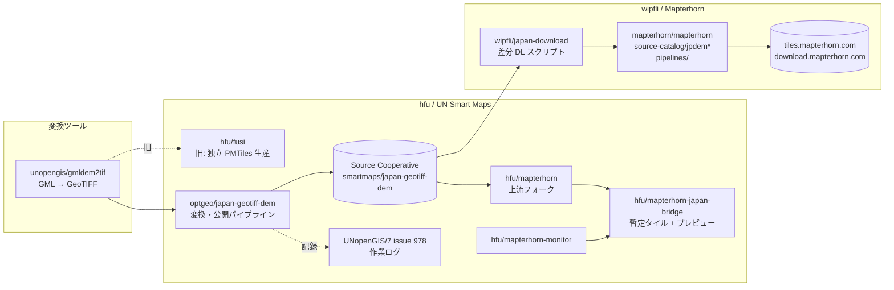

# Mapterhorn における日本の標高データ取り込み 調査メモ

- 調査日: 2026-09-07
- 対象: https://github.com/mapterhorn/mapterhorn （フォーク: https://github.com/shiwaku/mapterhorn ）
- ローカルクローン: `C:\Users\yshiw\Documents\GIS\Mapterhorn\mapterhorn`（`upstream` リモート追加済み）
- 調査時点の上流 main: `53e4d3d Fix rounding on downsampling bug (#308)`。フォーク main は上流と同一（ahead 0 / behind 0）

---

## 1. 結論（要約）

- 日本の標高は国土地理院「基盤地図情報（数値標高モデル）」の6製品が、独立した6ソース `jpdem1a` / `jpdem5a` / `jpdem5b` / `jpdem5c` / `jpdem10a` / `jpdem10b` として `source-catalog/` に登録されている。
- 2025-12-17 の上流 PR #165 で追加。作業は hfu さん、PR 作成は wipfli さん（Mapterhorn リード）。
- 本番配信（`download.mapterhorn.com/attribution.json`、全148ソース）に既に含まれている。
- 2026-09-05 の PR #309「Update jpdem」（未マージ）で、承認番号の更新と取り込み手順の全面差し替えが進行中。新手順は Source Cooperative 経由の差分更新。
- hfu さん側の作業ログは UNopenGIS/7 issue #978「Mapterhorn Japan Continuous Improvement (JCI) 2026-09」。
- データ量（2026-09-07 実測）: Source Cooperative の GeoTIFF は latest 359.6 GB（71.9万ファイル、うち 1m が 330 GB）。Mapterhorn の tarball は計 208.3 GB で、5m/10A は 2026-09-05〜06 に JCI 版へ更新済み、1m は 2025-12 版のまま。配信バンドルの日本域 z13+ は 21 本 233.4 GB（詳細は 4.6 節）。

---

## 1.5 時系列（日本 DEM が Mapterhorn に取り込まれるまでの背景）

### フェーズ0: 前史（変換ツールの整備）

| 日付 | 出来事 | 出典 |
|---|---|---|
| 2024-05-26 | UNopenGIS で `gmldem2tif`（GSI の GML DEM → GeoTIFF 変換、Ruby）リポジトリ作成。takano32 さん・smellman さんが主に開発 | GitHub repo 作成日 |

### フェーズ1: hfu さんによる独立実装（fusi）

| 日付 | 出来事 | 出典 |
|---|---|---|
| 2025-11-03 | `hfu/fusi` 作成。Mapterhorn のコードを参考に GSI GeoTIFF → Terrarium PMTiles を生成する日本向けツールチェーン | repo 作成日 |
| 2025-11-13 / 11-29 | ビューア `fusite` / `fusite2` 作成 | repo 作成日 |
| 2025-11-26 | 長崎県域でスモークテスト（maxzoom 16、約8.8万タイル） | fusi README |
| この時点の承認 | hfu さん個人名義の使用承認「R 6JHs 133」で Terrarium 生産。更新申請中 | issue #142 本文 |

### フェーズ2: 上流への提案と初回取り込み（PR #165）

| 日付 | 出来事 | 出典 |
|---|---|---|
| 2025-12-01 | hfu さんが上流 issue #142 を作成。「fusi で全国生産後に日本 DEM を upstream 貢献したい」と提案。入力 GeoTIFF 約53万ファイル | issue #142 |
| 2025-12-01 | wipfli さん即日回答。「10m/5m/1m の3ソースとして追加、GML ではなく gmldem2tif 出力を tarball で共有してほしい。ライセンスは CC-BY 相当以下であること」 | issue #142 |
| 2025-12-04 | fusi で初の全国規模生産成功（PMTiles 207 GiB） | issue #142 |
| 2025-12-15 | hfu さんが全 GSI データを再ダウンロードし GeoTIFF 化。6製品（1a/5a/5b/5c/10a/10b）の優先順位を提案。250 GB の tarball を `r2.optgeo.org/japan.tar` に公開。metadata.json 案（承認番号 R 7JHs 542）を提示 | issue #142 |
| 2025-12-16 | wipfli さんがダウンロード・SHA256 検証・パイプライン実行。ビルド成功 | issue #142 |
| 2025-12-17 | **PR #165 マージ**。6ソース `jpdem*` が source-catalog に追加（v0.0.7 に収録） | PR #165, CHANGELOG |
| 2025-12-31 | `fusite3`（Mapterhorn-fusi 統合後のビューア）作成 | repo 作成日 |

### フェーズ3: 更新体制の模索（Source Cooperative と承認）

| 日付 | 出来事 | 出典 |
|---|---|---|
| 2026-02-27 | GSI が DEM 更新を公開 | issue #142 |
| 2026-02-28 | hfu さん「更新を反映したいがすぐには着手しない。誰か主導してくれれば手伝う」 | issue #142 |
| 2026-05-08 | wipfli さん「自分で日本データ更新を回したい。手順を知りたい」 | issue #142 |
| 2026-05-11 | hfu さんが残タスク整理。GML ダウンロード手順書、gmldem2tif 変換、前処理済み GeoTIFF の Source Cooperative 共有を提案。wipfli さん「Source Cooperative は理想的」 | issue #142 |
| 2026-05-15 | hfu さんが GSI と2段階の調整を開始（①前処理 GeoTIFF の配布、②Mapterhorn での利用） | issue #142 |
| 2026-05-20 | GSI から **複製承認 R8JHf51** 取得（Source Cooperative での GeoTIFF 配布） | issue #142, japan-geotiff-dem README |
| 2026-05-21 | `optgeo/japan-geotiff-dem`（変換・公開パイプライン、UN Smart Maps）作成 | repo 作成日 |
| 2026-05-25 | 全国初回ベースラインを Source Cooperative に公開 | issue #978 コメント |
| 2026-05-31 | hfu さんが `smartmaps/japan-geotiff-dem` 公開を報告。Mapterhorn 名義（維持者: wipfli さん、日本窓口: hfu さん）で GSI 使用承認を申請することを提案 | issue #142 |
| 2026-06-02 | wipfli さん承諾、hfu さんが申請 | issue #142 |
| 2026-06-10 | 上流で metadata.json に `producer_short` 追加（全ソース一括、#270） | git log |
| 2026-06-15 | GSI から **使用承認 R 8JHs 131** 取得（国地情使 第131号、測量法第30条第1項、宛先「Mapterhorn 維持者」）。wipfli さん「次回リリースで attribution を更新」 | issue #142 |

### フェーズ4: JCI 2026-09（継続更新サイクル第1回）

| 日付 | 出来事 | 出典 |
|---|---|---|
| 2026-07-17 | `hfu/mapterhorn`（上流フォーク、日本ブリッジ用パイプライン）作成 | repo 作成日 |
| 2026-07-31 | GSI が DEM1A/DEM5A を更新（部分更新、新旧測量日が混在） | issue #142 |
| 2026-08-08 | hfu さんが再処理開始（北海道から）。`hfu/mapterhorn-japan-bridge`（暫定の日本 Terrarium PMTiles）作成 | issue #142, repo 作成日 |
| 2026-08-18 | UNopenGIS/7 **issue #978「JCI 2026-09」** 作成。`latest_file_list` / `obsolete_file_list` の生成・公開完了。差分スキップ（D14）・逐次処理（D15）の仕組みが揃い、北海道・四国・中国・近畿・東北（一部）を処理 | issue #978 |
| 2026-08-19 | 東北・北陸・関東3・関東2・関東1・中部を処理。**1m 全国11ゾーン完了** | issue #978 |
| 2026-08-20 | **5m 全国11ゾーン完了**。issue #142 で wipfli さんに完了報告と `latest_file_list.csv.gz` の使い方を案内 | issue #978, #142 |
| 2026-08-21 | wipfli さん「Perfect, thanks!」。同日 `wipfli/japan-download` 作成 | issue #142, repo 作成日 |
| 2026-08-30 | `hfu/mapterhorn-monitor`（Open MCT ベースの生産監視）作成 | repo 作成日 |
| 2026-09-02 | issue #978 クローズ。「次回は11月末想定の GSI 更新に備える」 | issue #978 |
| 2026-09-05 | wipfli さんが **PR #309「Update jpdem」** 作成（承認番号 R 8JHs 131、Justfile 削除、japan-download へ誘導） | PR #309 |
| 2026-09-06 | hfu さん「PR #309 につながった。嬉しい」 | issue #978 |
| 2026-09-07 | 調査時点。PR #309 は未マージ | — |

### 承認番号の整理

| 番号 | 種別 | 名義・用途 | 時期 |
|---|---|---|---|
| R 6JHs 133 | 使用 | hfu さん個人、fusi での Terrarium 生産 | 2024年度 |
| R 7JHs 542 | 使用 | hfu さん、PR #165 の metadata.json に記載 | 2025年度 |
| R8JHf51 | 複製 | UN Smart Maps、Source Cooperative での GeoTIFF 配布 | 2026-05-20 |
| R 8JHs 131 | 使用 | Mapterhorn 維持者（wipfli さん）名義、PR #309 で反映 | 2026-06-15 |

---

## 1.6 全体フロー図

### 新経路（PR #309 以降、JCI サイクル）

```mermaid
flowchart TD
    subgraph GSI["国土地理院（GSI）"]
        A[基盤地図情報 DEM<br/>DEM1A / 5A / 5B / 5C / 10A / 10B<br/>ZIP 化 JPGIS GML<br/>更新は新ファイル名で追加公開]
    end

    subgraph HFU["hfu さん側（UN Smart Maps）<br/>optgeo/japan-geotiff-dem"]
        B[手動ダウンロード<br/>11 ゾーン × パック] --> C[just extract]
        C --> D[skip-published<br/>既公開メッシュをスキップ]
        D --> E[convert<br/>gmldem2tif で GeoTIFF 化<br/>EPSG:6668, ZSTD]
        E --> F[sync<br/>S3 アップロード・サイズ照合]
        F --> G[filelists<br/>latest / obsolete_file_list.csv.gz<br/>url, size, md5]
    end

    subgraph SC["Source Cooperative<br/>smartmaps/japan-geotiff-dem（複製承認 R8JHf51）"]
        H["1/ 5/ 10/<br/>1 メッシュ 1 GeoTIFF"]
        I[latest_file_list.csv.gz<br/>obsolete_file_list.csv.gz]
    end

    subgraph WIP["wipfli さん側<br/>wipfli/japan-download"]
        J[既存 tarball を展開<br/>source_extract_tarball.py] --> K[to_download_and_delete.py<br/>latest と bounds.csv を比較<br/>ファイル名の DEM5A 等でソース振り分け]
        K --> L[差分のみ wget 並列 DL<br/>to-download/jpdem*/file_list.txt]
        K --> M[廃止ファイル削除<br/>to-delete/jpdem*/file_list.txt]
        L --> N[source_to_cog.py<br/>LERC 圧縮 COG]
        N --> O[rsync で本体にマージ]
        M --> O
        O --> P[source_bounds.py → bounds.csv]
        P --> Q[source_polygonize.py]
    end

    subgraph MH["mapterhorn/mapterhorn 共通パイプライン"]
        R[source-store/jpdem1a … jpdem10b] --> S[aggregation covering<br/>maxzoom を画素サイズから決定]
        S --> T[aggregation run<br/>EPSG:3857 再投影<br/>優先順位: 1a > 5a > 5b > 5c > 10a > 10b > GLO-30<br/>nodata を下位で埋め境界をぼかす]
        T --> U[Terrarium エンコード<br/>WebP → PMTiles]
        U --> V[downsampling → bundle]
    end

    subgraph OUT["配信"]
        W["tiles.mapterhorn.com/{z}/{x}/{y}.webp"]
        X[download.mapterhorn.com<br/>sources/jpdem*.tar<br/>attribution.json（R 8JHs 131 表示）]
    end

    subgraph META["source-catalog/jpdem*（PR 309）"]
        Y[metadata.json: 承認番号 R 8JHs 131<br/>LICENSE.pdf: 承認書<br/>README: japan-download へのリンク]
    end

    A --> B
    F --> H
    G --> I
    I --> K
    H --> L
    Q --> R
    V --> W
    V --> X
    Y -.attribution.py が参照.-> X

    subgraph BRIDGE["暫定: hfu/mapterhorn-japan-bridge"]
        Z[hfu/mapterhorn フォークで<br/>日本のみ独自生産<br/>上流が追いつけば廃止予定]
    end
    H -.-> Z
```

### 旧経路（PR #165、2025-12。現在の main に記載の手順）



### 登場する仕組みの関係（静的な構成図）



---

## 2. 登録ソース一覧（PR #165 時点 = 現在の main）

| ソース名 | 元データ | 解像度 | 公開 tarball サイズ（実測 HEAD） |
|---|---|---|---|
| jpdem1a | DEM1A（航空レーザ） | 1 m | 約 182 GB |
| jpdem5a | DEM5A（航空レーザ） | 5 m | 約 19 GB |
| jpdem5b | DEM5B（写真測量） | 5 m | 約 2 GB |
| jpdem5c | DEM5C | 5 m | 約 1.2 GB |
| jpdem10a | DEM10A（火山基本図） | 10 m | 約 36 MB |
| jpdem10b | DEM10B（地形図等高線） | 10 m | 約 3.6 GB |

tarball URL: `https://download.mapterhorn.com/sources/{source}.tar`

### metadata.json（6ソース共通、解像度のみ異なる）

```json
{
    "name": "基盤地図情報（数値標高モデル）",
    "website": "https://service.gsi.go.jp/kiban/app/",
    "license": "国土地理院コンテンツ利用規約／測量法に基づく国土地理院長承認（使用）R 7JHs 542",
    "producer": "国土交通省国土地理院",
    "producer_short": "GSI",
    "resolution": 1.0,
    "access_year": 2025
}
```

### 各フォルダの構成

`Justfile` / `LICENSE.pdf` / `README.md` / `metadata.json` の4ファイル。
他の多くのソースにある `file_list.txt`（ダウンロード URL 一覧）は **無い**。基盤地図情報ダウンロードサイトがログイン必須のため、自動ダウンロード対象外。

### 変更履歴（main）

| コミット | 日付 | 内容 |
|---|---|---|
| 524500f | 2025-12-17 | Add sources jp*: Japan, 1m, 5m, and 10m (#165) |
| 328d56f | 2026-06-10 | Add producer_short key in metadata.json (#270)（全ソース一括） |

---

## 3. 旧手順（現在の main に書かれている取り込みフロー）

README.md の記述（6ソース共通）:

```
- Convert source data to plain GeoTIFF using https://github.com/unopengis/gemdem2tif
- Follow the Mapterhorn method in the pipeline defined at https://github.com/hfu/fusi
```

※ README の `gemdem2tif` は誤記。実体は https://github.com/unopengis/gmldem2tif （Ruby 製、JPGIS GML DEM → Float32 GeoTIFF。ZSTD 圧縮、512px タイル、PREDICTOR=3）。

### 手順

1. GSI 基盤地図情報サイトから ZIP 化 GML を手動ダウンロード
2. `gmldem2tif` で GeoTIFF に変換
3. 変換済み GeoTIFF を `pipelines/source-store/{source}/` に配置
4. 各ソースの Justfile を `pipelines/` から実行

```
uv run python source_to_cog.py {source}        # LERC 圧縮 COG（MAX_Z_ERROR=0.001）に再変換
uv run python source_bounds.py {source}        # EPSG:3857 での bbox 一覧 bounds.csv を作成
uv run python source_polygonize.py {source} 32 # 有効データ範囲のポリゴン化（GPKG）
uv run python source_create_tarball.py {source} # tar-store に固めて配布用にする
```

5. 以降は日本固有処理なし。全世界共通の aggregation（covering → run）で Web メルカトルへ再投影、Terrarium エンコード、WebP、PMTiles。

### hfu/fusi との関係

`hfu/fusi` は上流取り込み前の日本向け独立実装（GeoTIFF → Terrarium PMTiles、mapterhorn の手法を参考に構築）。上流 issue #142 で hfu さんが「fusi で全国生産後に upstream 貢献したい」と提案 → PR #165 に至った。

---

## 4. 6ソースの重ね合わせ順（優先順位）

`pipelines/README.md` の aggregation 規則:

> group the source items by source and maxzoom, and order them such that **higher maxzoom is more important than lower**, and **earlier lexicographic names are more important than later**.

- maxzoom は各 GeoTIFF の画素サイズから自動計算（`aggregation_covering.py` の `get_smallest_overzoom`）
- 上位ソースの nodata 部分を下位で埋め、境界にガウスぼかし

結果として日本では:

```
jpdem1a (1m) > jpdem5a > jpdem5b > jpdem5c (5m, 名前順) > jpdem10a > jpdem10b (10m, 名前順) > GLO-30 等の全球ソース
```

GSI の製品区分（5A/5B/5C、10A/10B）をソース名末尾の a/b/c にそのまま写して優先順位にしている。hfu/mapterhorn-japan-bridge の優先順位（1m > 5a > 5b > 5c > 10a > 10b > sea/GLO-30）とも一致。

---

## 4.5 タイル生成の流れ（共通パイプラインを日本データがどう通るか）

ソース準備（第3節・第6節）が終わった後は日本固有の処理は無く、`pipelines/README.md` に書かれた全世界共通の4段階を通る。以下はその要点を日本データの観点で整理したもの。出典は `pipelines/README.md`、`aggregation_covering.py`、`utils.py`。

### 全体像

```
Source（ソース準備）→ Aggregation（再投影・マージ・maxzoom のみのタイル化）
→ Downsampling（オーバービュー生成）→ Bundle（配信用 PMTiles に束ねる）
```

前提: 最終タイルは 512×512 px、Web メルカトル（EPSG:3857）、Terrarium エンコード、Lossless WebP、PMTiles。

### 1) Aggregation covering（計画）

1. 全ソースの `bounds.csv` を読み、各 GeoTIFF の bbox をバッファして交差する **z12 タイル（マクロタイル）** を求める。
2. 各 GeoTIFF について、bbox と画素数から **maxzoom**（元データを完全に解像できる最小の Web メルカトルズーム）を算出する。判定は「z の 3857 画素サイズが元データの水平・垂直の画素サイズより小さくなる最小の z」。
3. マクロタイルを「関与するソースと maxzoom の組」でグループ化し、同グループを結合して **aggregation tile** にまとめる。幅は最大 64×512 = 32,768 px（maxzoom と extent zoom の差が 6 以内）。
4. 作業指示を `aggregation-store/{aggregation_id}/{z}-{x}-{y}-{child_z}-aggregation.csv` に書き出す（source, filename, maxzoom の一覧）。

**日本データの maxzoom の目安**（EPSG:6668 の地理座標グリッドを 3857 に投影すると、緯度 φ で画素サイズが 1/cos φ 倍になる）

| ソース | 地上解像度 | 3857 上の画素サイズ（北緯35°、×1.22） | 算出される maxzoom |
|---|---|---|---|
| jpdem1a | 1 m | 約 1.22 m | **16**（z16 の画素 1.19 m）。沖縄など低緯度では 17 になりうる |
| jpdem5a/5b/5c | 5 m | 約 6.1 m | **14**（z14 の画素 4.78 m） |
| jpdem10a/10b | 10 m | 約 12.2 m | **13**（z13 の画素 9.55 m） |
| glo30（フォールバック） | 30 m | 約 36.6 m | 11〜12 |

fusi README が「dem1a は max zoom 16 を自動選択」としているのと一致する。

### 2) Aggregation run（実行）

1. 最新の aggregation_id の各 aggregation item を処理。**前回の aggregation と同一内容なら skip**（この仕組みで JCI のような差分更新が全球再計算なしに済む）。
2. 関係する GeoTIFF を SSD 上の作業フォルダにコピー。
3. ソース項目を **(source, maxzoom) でグループ化し、maxzoom 降順、同順位は名前の辞書順** に並べる。日本では `jpdem1a(16) → jpdem5a(14) → jpdem5b(14) → jpdem5c(14) → jpdem10a(13) → jpdem10b(13) → glo30(11-12)`。
4. 優先度の高いグループから順に、gdal で VRT 作成 → 3857 へ warp → rasterio で nodata の有無を確認。**nodata が無くなった時点で打ち切り**（1m が全面を覆う aggregation tile では 5m 以下は処理されない）。
5. 複数の tif ができた場合、最良のものの nodata 画素を次善で塗り、さらに残れば三番目で塗る。塗った境界線（seam）を記録し、そこに **ガウスぼかし** をかけて段差を緩和。
6. 完成した float32 の集約 tif を 512×512 に切り、Terrarium エンコードして Lossless WebP に書き、1 ズームレベルのみの PMTiles として `pmtiles-store/` に保存（z≥7 は `pmtiles-store/7-{x}-{y}/` のサブフォルダ）。

### 3) Terrarium エンコードと垂直丸め（utils.py）

```
value = elevation + 32768
R = value // 256
G = value % 256
B = (value - floor(value)) * 256
```

タイルサイズ削減のため、ズームごとに垂直解像度を丸める（Terrarium 最大解像度 1/256 m ≈ 3.9 mm を z19 とし、低ズームでは 2 のべき乗で粗くする。上限 32 m）。日本データが関係する範囲を抜粋:

| z | 3857 画素サイズ | 垂直解像度 | 備考 |
|---|---|---|---|
| 11 | 38.2 m | 1 m | |
| 12 | 19.1 m | 50 cm | glo30 の maxzoom 付近 |
| 13 | 9.55 m | 25 cm | jpdem10a/10b の maxzoom |
| 14 | 4.78 m | 12.5 cm | jpdem5a/5b/5c の maxzoom |
| 15 | 2.39 m | 6.3 cm | |
| 16 | 1.19 m | 3.1 cm | jpdem1a の maxzoom |
| 17 | 0.597 m | 1.6 cm | 低緯度の jpdem1a |

この丸めにより隣接画素間の最小傾斜角はどのズームでも約 1.5° で一定になる。

### 4) Downsampling（オーバービュー）

- covering: 最高ズームから 0 まで下りながら、aggregation item と既生成の downsampling item の extent を読み、最大 32,768 px 幅にまとめて `{z}-{x}-{y}-{child_z}-downsampling.csv` を書く。
- run: 子 4 タイル（1024×1024 float32）を **2×2 平均** で 512×512 に縮小し、再度 Terrarium + WebP + 単一ズーム PMTiles として保存。関与する aggregation item が前回と同一なら skip。

### 5) Bundle（配信形）

`pmtiles-store/` の単一ズーム PMTiles（数千個）を多段ピラミッドに束ねる。

- `planet.pmtiles`: z0〜z12 の全タイル
- `6-{x}-{y}.pmtiles`: z6 タイル `6-{x}-{y}` 配下の z13 以上

配信は `https://tiles.mapterhorn.com/{z}/{x}/{y}.webp`（encoding: terrarium、tileSize: 512）。

### 日本データに関する含意

- 日本のタイルは沿岸部など 1m 未整備域を除き、**z16 まで実データ**（z17 以上はクライアント側のオーバーズーム）。
- 1m 整備域では z16 の垂直解像度 3.1 cm で保存されるため、GSI DEM1A の元精度（0.1 m 単位）は保たれる。
- GSI の nodata（海域・未計測）は優先順位の下位（5m → 10m → glo30）で埋まる。hfu/mapterhorn-japan-bridge も同じ順序で「1m > 5a > 5b > 5c > 10a > 10b > sea」としている。
- 差分更新の単位は aggregation item（最大 32,768 px 幅）。JCI で一部メッシュが更新されると、その GeoTIFF を含む aggregation item だけが再計算され、上位の downsampling も影響範囲だけ再生成される。
- ハードウェア目安（README）: 1スレッドあたり 2 GiB メモリ、32 コアで正規化済み入力 100 GiB/時。日本 6 ソースの tarball 合計は約 208 GB なので、全量再計算でも数時間規模。

---

## 4.6 データサイズの整理（ソース別・処理段階別）

集計日: 2026-09-07。単位は GB（10^9 バイト）。GiB 表記の出典値は GB に換算（×1.074）して併記。

### A. ソース（GSI 製品）別 × 段階別

| 製品 | ① GSI 原本 ZIP（GML） | ② hfu GeoTIFF 2025-12（ZSTD） | ③ Source Cooperative latest 2026-09（ZSTD GeoTIFF） | ④ Mapterhorn tarball（LERC COG） | ④ 最終更新 |
|---|---|---|---|---|---|
| DEM1A（1m） | 推定 約460 GB | 223.5 GiB ≈ 240 GB（184,050 ファイル） | **330.0 GB**（291,779 ファイル） | **182.2 GB** | 2025-12-21（**JCI 未反映**） |
| DEM5A（5m） | 5m 計 約21 GB（20パック） | 20.3 GiB ≈ 21.8 GB | 21.0 GB（357,648） | 19.4 GB | 2026-09-06（JCI 反映） |
| DEM5B（5m） | 〃 | 936.5 MiB ≈ 0.98 GB | 2.65 GB（43,152） | 1.99 GB | 2026-09-06（JCI 反映） |
| DEM5C（5m） | 〃 | 1.0 GiB ≈ 1.07 GB | 1.29 GB（21,319） | 1.17 GB | 2026-09-06（JCI 反映） |
| DEM10A（10m） | 不明 | 42.4 MiB ≈ 0.04 GB | 0.04 GB（96） | 0.036 GB | 2026-09-05 |
| DEM10B（10m） | 不明 | 4.5 GiB ≈ 4.83 GB | 4.53 GB（4,885） | 3.60 GB | 2025-12-21 |
| **合計** | — | ≈ 268.7 GB（tarball 実測 268.0 GB = 250 GiB） | **359.6 GB**（718,879 ファイル） | **208.3 GB** | — |

出典
- ①: optgeo/japan-geotiff-dem HANDOVER.md。北海道46パックで raw 87 GB、1パック約1.9 GiB の実測から、全国244パック（11ゾーン計）を掛けた推定値。5m は「20パック 約21 GB」の記述
- ②: 上流 issue #142 の hfu さんコメント（2025-12-15）。tarball は `r2.optgeo.org/japan.tar` 267,993,129,472 バイト
- ③: `https://data.source.coop/smartmaps/japan-geotiff-dem/{1,5,10}/latest_file_list.csv.gz` の size 列を製品名（ファイル名の `DEM5A` 等）で集計。obsolete は別掲
- ④: `https://download.mapterhorn.com/sources/jpdem*.tar` の HEAD（Content-Length / Last-Modified）

Source Cooperative の obsolete（旧測量日で置き換え済み、まだ保持）

| 解像度 | ファイル数 | サイズ |
|---|---|---|
| 1m | 17,076 | 14.25 GB |
| 5m（DEM5A のみ） | 48,943 | 2.86 GB |
| 10m | 0 | 0 |
| 合計 | 66,019 | 17.1 GB |

Source Cooperative 上の総量（latest + obsolete）: 約 376.7 GB。

### B. 気づき

- **Mapterhorn 側の tarball は 5m と 10A が 2026-09-05〜06 に更新済み**で、JCI 2026-09 の成果が既に取り込まれている。**1m（jpdem1a）だけは 2025-12-21 のまま**で未更新。1m は 330 GB と最大のため、ダウンロード・COG 化が進行中と推測される（PR #309 が OPEN のままなのもこれと整合）。`attribution.json` の tarball_size も 5b/5c/10a で HEAD と食い違っており、次回リリースまで古い値のまま。
- **1m は9か月で 240 GB → 330 GB（+37%）、ファイル数 184,050 → 291,779（+59%）**。JCI 第1回で 1m の整備範囲が大きく広がった。5B/5C も 2.7 倍・1.2 倍に増加。
- **LERC COG 化で ZSTD GeoTIFF の 75〜92% に縮む**（MAX_Z_ERROR=0.001 m の準可逆圧縮）。1m: 240 → 182 GB（76%）、5A: 21.0 → 19.4 GB（92%）、5B: 2.65 → 1.99 GB（75%）、10B: 4.83 → 3.60 GB（75%）。
- 5m のファイル数（42万）は 1m（29万）より多いが、サイズは 1/13。5m メッシュは 1m と同じ2次メッシュ分割で画素数が 1/25 のため。

### C. 処理段階別（パイプライン内の中間データと出力）

| 段階 | 置き場所 | 日本分のサイズ | 備考 |
|---|---|---|---|
| GSI 原本 ZIP（GML） | hfu 側ローカル | 1m 推定 約460 GB、5m 約21 GB | 処理後は削除される運用（HANDOVER） |
| gmldem2tif 出力 GeoTIFF（ZSTD、EPSG:6668） | Source Cooperative `smartmaps/japan-geotiff-dem` | latest 359.6 GB、obsolete 17.1 GB、計 376.7 GB | 1メッシュ1ファイル、71.9万ファイル |
| Mapterhorn `tar-store/jpdem*.tar` | download.mapterhorn.com/sources/ | 208.3 GB（1m 未更新時点） | 1m を JCI 版に更新すると 1m 単独で推定 250 GB 前後、計 280 GB 前後になる見込み（圧縮率 76% を適用） |
| `source-store/jpdem*/`（LERC COG） | wipfli 側 SSD | ≈ tar と同等（tar は無圧縮） | bounds.csv、polygon-store の GPKG は小容量 |
| `aggregation-store/`（作業一時） | SSD | 一時的。aggregation tile 1枚あたり最大 32,768² px × float32 ≈ 4 GB 非圧縮 | 処理後に削除 |
| `pmtiles-store/`（単一ズーム PMTiles: maxzoom + downsampling） | HDD | 日本分は未分離（全球で管理） | 参考: bridge 側の pmtiles-store 旧ディスクは 284 GB、stale データ 212 GB を削除した記録あり |
| **bundle 配信 z13+**（`6-{x}-{y}.pmtiles`） | download.mapterhorn.com | **日本域 21本 計 233.4 GB** | `download_urls.json` の size を日本域（z6 x53〜59, y22〜27）で集計。z13+ は maxzoom≥13 のソースがある場所にしか存在しないため、ほぼ全量が日本の DEM 由来 |
| bundle 配信 z0〜12（`planet.pmtiles`） | download.mapterhorn.com | 分離不可（全球 705.9 GB に含まれる） | |
| 全球 bundle 合計 | — | 458本 13.0 TB | 日本 z13+ は全球の約 1.8% |
| 参考: fusi 2025-12 全国 PMTiles | hfu 側 | 207 GiB ≈ 222 GB | maxzoom 16、Lossless WebP |
| 参考: mapterhorn-japan-bridge | stars.optgeo.org | 標高 314.66 GB + lineage 204.6 MB | HANDOVER.md D142/D145。GLO-30 フォールバック込み |

### D. 日本域 z13+ バンドルの内訳（1 GB 以上）

| ファイル | サイズ | おおよその範囲（経度 / 緯度） | 主な地域 |
|---|---|---|---|
| 6-55-25.pmtiles | 72.45 GB | 129.4〜135.0E / 32.0〜36.6N | 九州北部・中国・四国・近畿西部 |
| 6-56-25.pmtiles | 67.40 GB | 135.0〜140.6E / 32.0〜36.6N | 近畿・中部・関東 |
| 6-56-24.pmtiles | 42.63 GB | 135.0〜140.6E / 36.6〜41.0N | 北陸・関東北部・東北南部 |
| 6-57-24.pmtiles | 24.64 GB | 140.6〜146.3E / 36.6〜41.0N | 東北太平洋側 |
| 6-57-23.pmtiles | 11.84 GB | 140.6〜146.3E / 41.0〜45.1N | 北海道東部 |
| 6-56-23.pmtiles | 7.44 GB | 135.0〜140.6E / 41.0〜45.1N | 北海道西部 |
| 6-55-26.pmtiles | 4.57 GB | 129.4〜135.0E / 27.7〜32.0N | 九州南部 |
| 6-54-25.pmtiles | 1.14 GB | 123.8〜129.4E / 32.0〜36.6N | 長崎・五島・対馬 |
| 6-54-27.pmtiles | 0.97 GB | 123.8〜129.4E / 22.6〜27.7N | 沖縄・先島 |
| その他 12本 | 計 約0.35 GB | — | 小笠原、北方四島周辺など |

※ この bundle は調査時点の配信リリースであり、JCI 2026-09 の 5m 更新や 1m 更新はまだ反映されていない可能性が高い（tarball の更新日が 2026-09-05 以降のため）。

### E. 国・地域別の入力データ量（全ソース比較）

出典: `https://download.mapterhorn.com/attribution.json`（2026-09-07 取得、148 ソース、tarball 合計 19.65 TB）。ソース名の先頭 2 文字の国コードで集計し、スイス（`swissalti3d` と `chzh`）、イタリア（`it*` と `tinitaly`）、台湾・ラトビア（`aatw` / `aalv`）は手で振り分け直した。値は Mapterhorn の LERC COG tarball サイズで、A 表の④列と同じ基準。

| 順位 | 国・地域 | tarball 合計 | ソース数 | 解像度 | 主な提供元 |
|---|---|---|---|---|---|
| 1 | アメリカ | 9,372 GB | 34 | 1 m / 10 m | USGS 3DEP |
| 2 | フランス（海外県含む） | 2,707 GB | 21 | 0.5 / 1 / 5 m | IGN RGE ALTI・LiDAR HD |
| 3 | スペイン | 1,336 GB | 11 | 0.5 / 2 / 5 m | CNIG |
| 4 | ドイツ（州別） | 1,094 GB | 17 | 0.25 / 1 m | 各州測量局 |
| 5 | デンマーク（フェロー・グリーンランド含む） | 898 GB | 3 | 0.4 / 2 / 10 m | Klimadatastyrelsen |
| 6 | カナダ | 526 GB | 1 | 2 m | NRCan HRDEM |
| 7 | ノルウェー（スバールバル含む） | 441 GB | 2 | 1 / 20 m | Kartverket・Norwegian Polar Institute |
| 8 | スウェーデン | 398 GB | 1 | 1 m | Lantmäteriet |
| 9 | ポルトガル（マデイラ含む） | 353 GB | 2 | 0.5 / 10 m | DGT |
| 10 | ニュージーランド | 319 GB | 1 | 1 m | LINZ |
| 11 | イギリス（イングランド・スコットランド・ウェールズ） | 316 GB | 3 | 1 m | Environment Agency 他 |
| 12 | 全球フォールバック GLO-30 | 306 GB | 1 | 30 m | Copernicus（DLR / Airbus） |
| 13 | スイス（swissALTI3D + チューリッヒ州） | 252 GB | 2 | 0.5 / 0.25 m | swisstopo・Kanton Zürich |
| 14 | オーストリア | 236 GB | 6 | 1 / 5 / 10 m | BEV・各州 |
| 15 | ポーランド | 234 GB | 2 | 1 / 5 m | GUGiK |
| 16 | フィンランド | 229 GB | 1 | 2 m | NLS |
| 17 | **日本** | **206 GB** | **6** | **1 / 5 / 10 m** | **国土地理院** |
| 18 | ベルギー | 91 GB | 2 | 0.5 / 1 m | Digitaal Vlaanderen・SPW |
| 19 | オーストラリア（タスマニア含む） | 65 GB | 10 | 2 / 5 m | Geoscience Australia・The LIST |
| 20 | スロバキア | 61 GB | 1 | 1 m | ÚGKK SR |
| 21 | スロベニア | 54 GB | 1 | 1 m | ARSO |
| 22 | エストニア | 51 GB | 1 | 1 m | Land and Spatial Development Board |
| 23 | イタリア（州別 + TINITALY） | 46 GB | 9 | 1〜10 m | 各州・INGV |
| 24 | ルーマニア | 38 GB | 1 | 0.5 m | geoportal.gov.ro |
| 25 | キプロス | 7.0 GB | 1 | 1 m | Department of Lands and Surveys |
| 26 | ルクセンブルク | 4.8 GB | 1 | 0.5 m | ACT |
| 27 | チェコ | 3.9 GB | 1 | 5 m | ČÚZK |
| 28 | アイスランド | 3.2 GB | 2 | 10 m | NSI・ASTER GDEM |
| 29 | オランダ（本国） | 1.2 GB | 1 | 5 m | AHN |
| 30 | 台湾 | 0.4 GB | 1 | 20 m | 内政部国土測繪中心 |
| 31 | ルワンダ | 0.3 GB | 1 | 10 m | NLA / WASAC |
| 32 | ラトビア | 0.02 GB | 1 | 20 m | LĢIA |

読み方の注意

- 日本は 148 ソース中 17 位で全体の約 1%。アメリカ 1 か国で 48% を占める。
- `attribution.json` は配信リリース時点の値。日本は 205.9 GB と出るが、HEAD 実測は 208.3 GB（5m・10A の tarball が 2026-09-05〜06 に更新済みで、attribution.json が未更新のため）。他国も同様にリリース時点の値。
- tarball は入力データ量であり配信タイル量ではない。配信量は z6 バンドル単位でしか分からず国境をまたぐため、国別には厳密に分けられない。日本のような島国なら D 表のように近似できる。
- ドイツ・イタリアは州ごと、オーストラリアは地域ブロックごと、アメリカは 1m ブロックごとに別ソースになっており、国としての合計はこの集計で初めて出る。
- source-catalog にはオランダのカリブ領（`nlcaribischa/b/c`）など `attribution.json` に無いソースもあり、次回リリースで追加される見込み。

### F. 国・地域別 × 解像度別の被覆面積

出典: `https://download.mapterhorn.com/coverage.pmtiles`（342 MB、2026-08-20 更新。ローカル複製: `Documents\GIS\Mapterhorn\coverage.pmtiles`）。全 148 ソースの有効範囲ポリゴンをベクタタイル化したもので、`pipelines/Coverage.java` が Planetiler で `polygon-store/*.gpkg` から生成している。z7 のタイル 9,129 枚を展開し、WGS84 楕円体上の測地面積を積算した（算出スクリプトはスクラッチパッドの `coverage_area.py` / `coverage_net.py`）。

**実効面積（net）の定義**: 同じ場所を複数解像度が覆うため単純合計は重複する。Mapterhorn の優先順位（解像度が細かい方が優先、同解像度は名前の辞書順）に従い、各地点をその地点で最も細かいソースに 1 回だけ割り当てた面積を net とした。以下の表は net。

| 国・地域 | 実効面積 | 国土面積 | 被覆率 | tarball | ≤0.5m | 1m | 2〜2.5m | 5m | 10m | >10m |
|---|---|---|---|---|---|---|---|---|---|---|
| アメリカ | 10,156,359 | 9,147,593 | 111% | 9,372 GB | | 6,901,384 | | | 3,254,974 | |
| デンマーク（グリーンランド含む） | 2,446,693 | 約2,210,000 | 111% | 898 GB | 49,456 | | 2,378,575 | | 18,662 | |
| カナダ | 1,679,350 | 9,093,507 | **18%** | 526 GB | | | 1,679,350 | | | |
| フランス（海外県含む） | 649,095 | 約640,000 | 101% | 2,707 GB | 479,354 | 151,111 | | 18,629 | | |
| スペイン | 540,062 | 498,980 | 108% | 1,336 GB | 204,134 | | 330,139 | 5,789 | | |
| ノルウェー（スバールバル含む） | 507,070 | 約385,000 | 132% | 441 GB | | 426,401 | | | | 80,670 |
| スウェーデン | 470,031 | 410,340 | 115% | 398 GB | | 470,031 | | | | |
| **日本** | **379,223** | **377,975** | **100%** | **206 GB** | | **185,534** | | **148,350** | **45,339** | |
| オーストラリア | 369,206 | 7,682,300 | **5%** | 65 GB | | | 68,625 | 300,580 | | |
| ドイツ | 360,585 | 348,672 | 103% | 1,094 GB | 36,499 | 324,086 | | | | |
| フィンランド | 359,412 | 303,890 | 118% | 229 GB | | | 359,412 | | | |
| ポーランド | 313,023 | 311,888 | 100% | 234 GB | | 261,714 | | 51,309 | | |
| イタリア | 300,900 | 294,140 | 102% | 46 GB | | 6,760 | 37,265 | 54,621 | 202,254 | |
| ニュージーランド | 232,380 | 268,021 | 87% | 319 GB | | 232,380 | | | | |
| イギリス | 188,384 | 約229,000 | 82% | 316 GB | | 188,384 | | | | |
| アイスランド | 180,849 | 100,250 | 180% | 3 GB | | | | | 180,849 | |
| オーストリア | 84,910 | 82,445 | 103% | 236 GB | | 84,704 | | 198 | 7 | |
| チェコ | 78,294 | 77,247 | 101% | 4 GB | | | | 78,294 | | |
| ポルトガル | 74,447 | 91,606 | 81% | 353 GB | 72,915 | | | | 1,532 | |
| ラトビア | 64,053 | 62,249 | 103% | 0.3 GB | | | | | | 64,053 |
| エストニア | 50,899 | 42,388 | 120% | 51 GB | | 50,899 | | | | |
| スロバキア | 49,157 | 48,105 | 102% | 61 GB | | 49,157 | | | | |
| スイス | 42,288 | 41,291 | 102% | 252 GB | 42,288 | | | | | |
| 台湾 | 36,214 | 35,980 | 101% | 0.1 GB | | | | | | 36,214 |
| ベルギー | 32,814 | 30,278 | 108% | 91 GB | 16,991 | 15,824 | | | | |
| ルーマニア | 27,981 | 231,291 | **12%** | 38 GB | 27,981 | | | | | |
| ルワンダ | 26,841 | 24,668 | 109% | 0.3 GB | | | | | 26,841 | |
| オランダ | 21,724 | 41,540 | 52% | 1 GB | | | | 21,724 | | |
| スロベニア | 20,880 | 20,140 | 104% | 54 GB | | 20,880 | | | | |
| キプロス | 5,981 | 9,251 | 65% | 7 GB | | 5,981 | | | | |
| ルクセンブルク | 3,353 | 2,586 | 130% | 5 GB | 3,353 | | | | | |
| **各国計** | **19,752,455** | — | — | **19.3 TB** | 932,970 | 9,375,229 | 4,853,366 | 679,495 | 3,730,459 | 180,936 |
| GLO-30（フォールバック） | 163,494,170 | — | — | 306 GB | | | | | | 163,494,170 |

単位は km²。空欄はその解像度帯の実効面積ゼロ。

### G. 面積からわかること

- **世界の陸地に対する高解像度 DEM の被覆率は 13.3%**（各国計 1,975 万 km² ÷ 陸地約 1.489 億 km²）。残りは GLO-30（30 m）が埋めている。
- **解像度帯別の世界内訳**: 1 m が 937 万 km²（47.5%）で最大。次に 2〜2.5 m が 485 万 km²（24.6%）、10 m が 373 万 km²（18.9%）。0.5 m 以下は 93 万 km²（4.7%）にとどまる。
- **日本は実効面積 37.9 万 km² で国土をほぼ 100% 被覆**。内訳は 1 m が 18.6 万 km²（49%）、5 m が 14.8 万 km²（39%）、10 m が 4.5 万 km²（12%）。**国土の約半分が 1 m で整備済み**という水準で、1 m 単独の面積では世界 6 位相当。
- **面積あたりのデータ量**（日本の実測）: 1 m は 0.98 GB / 1,000 km²、5 m は 0.06 GB / 1,000 km²、10 m は 0.01 GB / 1,000 km²。解像度が 5 分の 1 になるとデータ量は約 16 分の 1。
- **被覆が部分的な国**: オーストラリア 5%、ルーマニア 12%、カナダ 18%、オランダ 52%、キプロス 65%、ポルトガル 81%、イギリス 82%、ニュージーランド 87%。カナダの HRDEM は人口集中回廊のみ、オーストラリアは州別の一部地域のみ。
- **被覆率が 100% を超える国**は、海岸線バッファ、島嶼・海外領土、隣国にまたがるデータ、ポリゴン簡略化（`Coverage.java` の pixel tolerance 0.375 px）による膨張が原因。アイスランド 180% はポリゴンが粗いため。ノルウェー 132% はスバールバルを国土面積に含めていないため。
- **日本の tarball 206 GB は各国計 19.3 TB の約 1%** だが、実効面積では 1,975 万 km² の 1.9% を占める。1 m 主体のアメリカ（9.4 TB / 1,016 万 km²）と比べ、日本は面積あたりのデータ量が小さい（1 m の割合が 49% にとどまるため）。

**検証**: 日本の 10B ソース単独の被覆面積（重複込み）は 377,946 km² で、実際の国土面積 377,975 km² と比率 1.00。net 合計 379,223 km² も比率 1.003。z7 解像度でのジオメトリ精度は十分と判断できる。

### H. 用語: tarball

複数のファイルを 1 つにまとめた `.tar` 形式のアーカイブ。tar 自体は圧縮しない。Mapterhorn では、ソースごとの `source-store/{source}/` の中身（COG 化した GeoTIFF と `bounds.csv`）を `source_create_tarball.py` で `{source}.tar` に固め、`download.mapterhorn.com/sources/` に公開している。中身の GeoTIFF は LERC 圧縮済みなので tar のサイズはフォルダ合計とほぼ同じで、「入力データ量」の目安になる。作業マシンでは `source_extract_tarball.py` で展開して `source-store/` に戻してから処理を始める（japan-download の run.sh も最初にこれを行う）。元データの取得元を経由せずに同じ入力から再現するための公開物でもある。

---

## 4.7 シームレス統合の実装（日本の 6 ソースと全球データをどう繋いでいるか）

4.5 節が処理の流れ、この節が「継ぎ目を消す仕掛け」の実装詳細。出典は `pipelines/aggregation_reproject.py`、`aggregation_merge.py`、`aggregation_tile.py`、`utils.py`。

### 前提: 国ごとに分けた処理ではない

統合の単位は z12 マクロタイルをグループ化した aggregation tile で、**日本の 6 ソースと全球の GLO-30 は同じ作業単位の中で一緒に処理される**。国別・ソース別に別々にタイル化して後で貼り合わせる方式ではない。継ぎ目が生じ得る箇所は次の 3 種類あり、すべて同一の仕組みで扱われる。

1. 日本のソース間（1m と 5m、5m と 10m の境界）
2. 日本のソースと全球フォールバック（沿岸で 10B から GLO-30 へ）
3. aggregation tile 同士の境界（作業単位の継ぎ目）

### 1) 全ソースを「最も細かい格子」に揃えて投影する

`aggregation_reproject.py`。ソースごとに個別投影するのではなく、**その作業単位で最も細かいグループの解像度・範囲に全グループを揃えて** warp する。

```
gdalbuildvrt -input_file_list {i}-file-list.txt {i}.vrt      # グループ内のファイルを仮想ラスタに
gdalwarp -of vrt -t_srs EPSG:3857 -tr {res} {res} \
         -te {left-buf} {bottom-buf} {right+buf} {top+buf} \
         -r cubicspline -dstnodata -9999  {i}.vrt {i}-3857.vrt
gdal_translate -of COG -co COMPRESS=LERC -co MAX_Z_ERROR=0.001 ...
```

- `res` は **グループ 0（最優先＝最も細かい）の maxzoom の解像度**。1m がある場所では 5m も 10m も GLO-30 も 1m 格子（z16、1.194 m/px）に三次スプラインで補間される
- 全グループが同一原点・同一解像度になるため、画素単位で重ね合わせできる
- データの無い画素は `-9999`
- `gdalbuildvrt` が `heterogeneous projection` を報告したら例外。1 ソース内に複数 CRS があると弾かれる（だから `source_set_crs.py` がある）

### 2) 上位で埋まったら下位は読まない（早期打ち切り）

各グループを warp した直後に `contains_nodata_pixels()` で穴を確認し、穴が無ければ以降のグループは処理しない。**1m が全面を覆う場所では 5m 以下も GLO-30 も一切読み込まれない**。日本の国土の 49% がこれに該当する。

### 3) 150 m の余白（buffer）

`utils.macrotile_buffer_3857 = 150`（メートル）。作業単位の外側にこの幅の余白を付けて warp する（複数グループがある場合のみ）。

| 最細解像度 | 画素サイズ | 余白 | ぼかし σ | ぼかしの及ぶ幅（片側 4σ） |
|---|---|---|---|---|
| 1 m（z16） | 1.194 m | 125 px（149 m） | 30 px（36 m） | 約 143 m |
| 5 m（z14） | 4.777 m | 31 px（148 m） | 6 px（29 m） | 約 115 m |
| 10 m（z13） | 9.555 m | 15 px（143 m） | 2 px（19 m） | 約 76 m |

この余白が**作業単位の継ぎ目を消す仕掛け**。隣り合う作業単位が同じ余白データから同じ混ぜ方を計算するので、境界で食い違わない。余白はタイル化時に切り落とす。

### 4) 穴埋めと境界のぼかし（aggregation_merge.py）

512 画素の窓を余白分だけ広げて読み、窓ごとに次を実行する。

```
1. グループ0（最優先）を置く。NaN は -9999 に正規化
2. 穴が無ければ何もしない（filled_from_start）
3. 穴がある場合、優先度順に次グループで穴を埋める
   copy_mask = (merged == -9999) & (current != -9999)
   埋めるたびに境界を検出して累積:
     binary_erosion で 1 画素収縮 → boundary = mask & ~eroded
4. 窓の外周 4 辺の境界を除外（隣の窓と食い違わないため）
     boundary[0,:] = boundary[-1,:] = boundary[:,0] = boundary[:,-1] = 0
5. boundary &= eroded（有効域の内側だけに限定）
6. 境界があれば:
     残る穴を 0 m に
     sigma = max(int(overlap/4) - 1, 1)
     境界マスクをガウスぼかし → 正規化 → clip(0,1)
       → スムーズステップ 3w² - 2w³ で重みに
     標高もガウスぼかしした版を作る
     merged = w * blurred + (1 - w) * merged
7. 余白を切り落として書き出し
```

要点は **境界線の近傍だけを滑らかに混ぜ、内部の標高値は元のまま残す**こと。全面をぼかすわけではない。重みにスムーズステップを使うので、ぼかし域の端でも一次微分が連続になり、陰影表現で縞が出ない。

### 5) タイル化と低ズーム

`aggregation_tile.py` は余白を除いた領域を 512 画素ずつ切り出し、**残った穴を 0 m（海面）**にして Terrarium 符号化する。低ズームは `downsampling_run.py` が、既にシームレス化された子タイル 4 枚を復号して 1024×1024 にし、2×2 平均で 512 に縮める。**低ズームで統合をやり直さない**ので、ズーム間でも矛盾しない。

### 5-補) 低ズームの作り方をもう少し詳しく

**「1m の z16 タイルから z15 タイルを作っているのか」→ その通り。** `downsampling_covering.py` が `for child_zoom in reversed(range(1, 32))` で高い方から 1 段ずつ降り、`downsampling_run.py` が親 1 枚につき子 4 枚を処理する。1m 整備域なら次の連鎖になる。

```
z16（集約が生成した実データ）→ z15 → z14 → z13 → ... → z0
```

1 段の処理内容（`downsampling_run.py` の `create_tile`）

1. 子 4 枚の WebP を復号し、Terrarium の RGB から浮動小数点の標高に戻す
   `R * 256 + G + B / 256 - 32768`
2. 1024×1024 の配列に 2×2 で並べる
3. `reshape((512, 2, 512, 2)).mean(axis=(1, 3))` で **2×2 平均**して 512×512 に
4. 親のズームの垂直解像度で丸め直す（`get_rounded_elevation_data`）。z16 は 3.1 cm、z15 は 6.3 cm
5. 再び Terrarium 符号化して可逆 WebP で書き、単一ズームの PMTiles に詰める

**解像度ごとに起点のズームが違う**

集約が実データのタイルを作るのはその場所の最高ズームだけなので、縮小の起点が場所によって変わる。

| 場所 | 集約が作るズーム（実データ） | 縮小で作るズーム |
|---|---|---|
| 1m 整備域 | 16 | 15 以下 |
| 5m のみ | 14 | 13 以下 |
| 10m のみ | 13 | 12 以下 |

つまり **5m 整備域の z14 タイルは縮小産物ではなく、集約が 5m の実データから直接作ったもの**。同じ z14 でも 1m 域のものは z15 からの平均、5m 域のものは実データという違いがある。`downsampling_covering.py` の `get_extents_from_coverings()` が aggregation と downsampling の両方の extent を読むのはこのため。

**1 枚のタイル内で起点が混ざらない理由**

グループ化が z12 マクロタイル単位なので、1 つの作業単位の中では最高ズームが必ず一様。z13 以上のタイルは必ず 1 つの作業単位に収まるため、1 枚のタイルの中に「z15 から縮小した部分」と「5m 実データの部分」が混ざることはない。z12 のグループ化はこの一様性を担保する役割も持っている。

**コード内コメントの誤り**: `downsampling_run.py` の該当行のコメントは `# downsample by 4x4 pixel averaging` と書かれているが、実際の処理は 2×2 平均。コメントが実装と合っていない。

### 6) 日本での具体像

| 場所 | 使われるソース | タイルの最高ズーム | 国土比 |
|---|---|---|---|
| 1m 整備済み | jpdem1a のみ（早期打ち切り） | 16 | 49% |
| 5m のみ整備 | jpdem5a、穴があれば 5b・5c | 14 | 39% |
| 10m のみ | jpdem10b、火山部は 10a | 13 | 12% |
| 海・国土外 | glo30、無ければ 0 m | 11〜12 | — |

### 7) 限界: 鉛直系の変換をしていない

`pipelines/` 全体を検索したが、ジオイドモデルや EGM への変換処理は存在しない。`gdalwarp` は `-t_srs EPSG:3857` のみで水平投影しか変換していない。GSI の DEM は東京湾平均海面基準（T.P.）の標高、GLO-30 は EGM2008 基準の標高で、どちらもジオイド基準なので大きな矛盾は出ないが、**数十センチ程度の系統差は残る**。境界のぼかしがそれを目立たなくする役割も担っている。

### 8) 補助: source_fill_nodata.py（#306、2026-09-01 追加）

隣接ファイルの情報を使ってソース内部の穴をあらかじめ埋める処理。`buffer = 2 * macrotile_buffer_3857`（300 m）で近傍ファイルを探し、z10 タイルで空間インデックスを作る。ソース内のファイル境界を綺麗にするために後から入った仕組みで、日本ソースの Justfile には（PR #309 で Justfile 自体が削除されたため）含まれていない。

---

## 4.75 タイルの差分更新の仕組み

出典: `pipelines/aggregation_covering.py`、`aggregation_run.py`、`downsampling_covering.py`、`bundle.py`、`remove_dangling_pmtiles.py`、`utils.py`、`source-catalog/README.md`。

### 中核: 作業指示書の内容比較

covering を実行するたびに時刻順に並ぶ ID（ULID）が発行され、`aggregation-store/{ID}/` に作業指示書の CSV が書かれる。中身は「どのソースのどのファイルをどのズームで使うか」の一覧。

```
source,filename,maxzoom
jpdem1a,FG-GML-3927-05-84-DEM1A-20250423.tif,16
jpdem5a,FG-GML-3927-05-DEM5A-20240301.tif,14
```

差分判定は単純で、`utils.get_dirty_aggregation_filenames()` が**同じ名前の CSV について今回と前回の中身を文字列比較し、違えば dirty と判定する**だけ（`get_aggregation_item_string()` が改行を除いて連結した文字列を返す）。前回の ID が無ければ全件 dirty。

### GSI の命名規則が効く

日本のデータと噛み合っている点。GSI は更新データを既存ファイルの上書きではなく、**測量日を含む新しいファイル名**で公開する。そのため

1. 該当メッシュの CSV の行が別のファイル名に変わる
2. 中身が違うので dirty と判定される
3. そのメッシュを含む作業単位だけが再計算される

更新が無かった場所は CSV が一字一句同じなので処理が丸ごと飛ぶ。JCI で 1m の一部メッシュが更新されても全球を作り直す必要がない。

### 各段階への伝播

| 段階 | dirty 判定 | 実装 |
|---|---|---|
| 集約 | CSV の内容が前回と異なる | `write_aggregation_todos()` が `.todo` を添え、`aggregation_run.py` は `.todo` があるものだけ処理。完了で `.done` を書いて `.todo` を消すので中断・再開できる |
| 縮小 | ① dirty な集約タイルと交差する、または ② 前回の集約に同名の指示書が無かった | `write_downlsampling_todos()`。`is_parent_of_dirty_aggregation_tile()` と `not_in_previous_aggregation()`。z16 が更新されれば z15、z14 と順に上へ伝播 |
| バンドル | dirty な集約タイルの **z6 の親** | `bundle.py` の `get_dirty_parents()`。該当する z6 バンドルだけ再生成。ただし z0（planet.pmtiles）は常に対象に含まれる |
| 掃除 | 現在の指示書から期待されないファイル | `remove_dangling_pmtiles.py` が期待ファイル名の集合を作り、含まれない PMTiles を削除。ソース削除時の後片付け |

### 1m の 1 メッシュが更新された場合の再計算範囲

| 段階 | 再計算される範囲 |
|---|---|
| 集約 | そのメッシュを含む作業単位 1 つ（最大 32,768 画素幅） |
| 縮小 | その作業単位の親にあたる z15 以下のタイル |
| バンドル | 該当する z6 バンドル 1 本 + `planet.pmtiles` |

作業単位が z12 マクロタイルのグループなので、1 メッシュの更新でも数十 km 四方が再計算される。粒度を細かくしないのは、シームレス化のために周囲のデータを一緒に読む必要があるため（4.7 節の 150 m 余白）。

### 前提と注意点

差分判定は**ファイル名の変化に依存**している。ソース側が同じファイル名で中身だけ差し替えると検出できない。`source-catalog/README.md` にこの前提が明記されている。

> Mapterhorn assumes that the contents of a file do not change as long as the filename stays the same. Source producers are expected to publish files with updated names if they publish new data.

GSI はこの前提を満たしている。また Source Cooperative の `latest_file_list.csv.gz` / `obsolete_file_list.csv.gz` は、同じ前提の上で「セルごとの現在ファイル」を機械可読にしたもので、`japan-download` の差分判定（4.6 節 C の source-store 段階）と、この aggregation の差分判定が二段構えになっている。

| 段構え | 何を比較するか | 担当 |
|---|---|---|
| 1段目 | Source Cooperative の latest 一覧 vs 手元の bounds.csv | `to_download_and_delete.py`（本家側）。ダウンロードと COG 化の対象を絞る |
| 2段目 | 今回の aggregation CSV vs 前回の aggregation CSV | `aggregation_covering.py`。タイル再生成の対象を絞る |

### Justfile に見るパイプライン実行順

`pipelines/Justfile` の default レシピ（全行コメントアウトされており、手で 1 つずつ流す運用）。

```
aggregation_covering.py      # 計画 + .todo 生成
downsampling_covering.py     # 計画 + .todo 生成
aggregation_run.py           # 実行（.todo のみ）
downsampling_run.py          # 実行（.todo のみ）
remove_dangling_pmtiles.py   # 掃除
create_index.py
bundle.py 1                  # dirty な z6 のみ再バンドル
download_urls.py 0.0.0
attribution.py               # attribution.json 生成
java -cp planetiler.jar Coverage.java  # coverage.pmtiles 生成
```

---

## 4.8 役割の境界: COG 化とタイル化はどちらが担当か

「日本が COG を提供して本家がタイル化している」という理解は概ね正しいが、**COG 化そのものも本家側**である点が異なる。

| 工程 | 担当 | 成果物の形式 |
|---|---|---|
| GSI からのダウンロード | 日本側（手作業、ログイン必須） | ZIP 化 JPGIS GML |
| GML → GeoTIFF | 日本側（`gmldem2tif`） | **ZSTD** 圧縮、512px タイル、PREDICTOR=3、**EPSG:6668** |
| Source Cooperative への公開・最新ファイル一覧生成 | 日本側 | 同上 + `latest/obsolete_file_list.csv.gz` |
| 差分判定・ダウンロード | 本家側（`japan-download`） | — |
| **LERC COG 化** | **本家側**（`source_to_cog.py`） | **LERC** 圧縮 COG、MAX_Z_ERROR=0.001 |
| bounds.csv、ポリゴン化 | 本家側 | CSV、GPKG |
| 統合・タイル化・オーバービュー・バンドル | 本家側 | Terrarium WebP、PMTiles |
| 配信 | 本家側 | `tiles.mapterhorn.com` |

再変換する理由

- 集約パイプラインが LERC COG を前提にしている
- ZSTD は可逆だが LERC は 1 mm 許容の準可逆で、日本の 1m データは 240 GB → 182 GB（約 76%）に縮む。全球 19.3 TB を扱う都合上この差が効く

将来の展望

- UNopenGIS/7 #978 に「GeoTIFF エンコーディングを Mapterhorn 式に合わせる件——将来の JCI サイクルの候補、2026-09 では扱わない」と明記されている。日本側が Mapterhorn 形式で提供すれば本家の再変換は不要になる
- 日本側は上流提供と並行して自前でもタイルを生産している（`hfu/mapterhorn-japan-bridge`、上流フォークを使用）。上流が GSI 更新に追いつくまでの暫定という位置づけで、追いついたら廃止する前提

---

## 4.9 配信と描画: ズームで読むファイルを振り分ける（2026-10-11 追記）

4.5 節 5) のとおり、配信は `planet.pmtiles`（z0–12、全球）と `6-{x}-{y}.pmtiles`（z13 以上、z6 タイル 1 枚分ずつ）に分かれている。描画するときは、タイル（z/x/y）ごとに読むファイルを次の 1 行で決める。

```js
const name = z <= 12 ? 'planet' : `6-${x >> (z - 6)}-${y >> (z - 6)}`;
```

- z13 以上は、そのタイルを含む z6 の親タイルのファイルを読む（`x >> (z - 6)` は 2^(z-6) で割って切り捨て）。z6 の 1 区画に z13 なら 128×128 枚が入る
- ファイル名がそのまま区画を表すので、タイル番号だけで読むファイルが一意に決まる。どのファイルに何が入っているかの一覧表は要らない
- サブピラミッドが無い所（細かいソースが無い場所）は読むファイルが無く、タイルが返らない

### 振り分けの場所は 2 通り

| 方法 | 振り分ける所 | 使い方 |
|---|---|---|
| 1. サーバー側 | Cloudflare Worker（`tiles.mapterhorn.com`）が上の式でファイルを選び、Range で 1 タイル読んで WebP で返す | 普通の ZXY / TileJSON。`https://tiles.mapterhorn.com/{z}/{x}/{y}.webp`、`https://tiles.mapterhorn.com/tilejson.json` |
| 2. ブラウザ側 | MapLibre の `addProtocol` で独自スキーム `mapterhorn://` を登録し、その中で上の式を使って `download.mapterhorn.com` の PMTiles を直接読む | `website/examples/pmtiles/example.html` |

方法 2 の上流の例（抜粋）:

```js
const protocol = new pmtiles.Protocol({ metadata: true, errorOnMissingTile: true });
maplibregl.addProtocol('mapterhorn', async (params, abortController) => {
  const [z, x, y] = params.url.replace('mapterhorn://', '').split('/').map(Number);
  const name = z <= 12 ? 'planet' : `6-${x >> (z - 6)}-${y >> (z - 6)}`;
  const url = `pmtiles://https://download.mapterhorn.com/${name}.pmtiles/${z}/${x}/${y}.webp`;
  const response = await protocol.tile({ ...params, url }, abortController);
  if (response['data'] === null) throw new Error(`Tile z=${z} x=${x} y=${y} not found.`);
  return response;
});
// source: { type: 'raster-dem', tiles: ['mapterhorn://{z}/{x}/{y}'], encoding: 'terrarium', tileSize: 512 }
```

### 公式サイトはどちらを使っているか（上流 `website/`、`53e4d3d` 時点）

公式の表示はほぼすべて方法 1。方法 2 は「Use Mapterhorn with PMTiles and addProtocol.」という例が 1 ページあるだけ。

| ページ | タイルの取り方 |
|---|---|
| ビューア（mapterhorn.com/viewer） | `tiles.mapterhorn.com/tilejson.json`（方法 1）。`#url=` で別の TileJSON か `.pmtiles` を渡せるが、`.pmtiles` は 1 本をそのまま表示するだけで振り分けはしない |
| 例: hillshade・terrain・contour・migration・attribute-visible-sources | `tiles.mapterhorn.com` の TileJSON か ZXY（方法 1） |
| 例: pmtiles | 方法 2 |
| coverage（mapterhorn.com/coverage） | `single-archive-tiles.mapterhorn.com`。標高タイルではなく、ソースの範囲を描く地図 |

### 自前の配信と検証での使い方

- `tiles.shi-works.com/mapterhorn/{z}/{x}/{y}.webp` は方法 1 と同じ構成。dem2tiles の Worker の `resolveArchive()`（`dem2tiles/worker/src/index.ts`）が同じ式で `planet-japan` か `6-x-y` を選ぶ。日本の外の z13 以上は R2 にキーが無く 404（japan-basemap-tile-pipeline リポジトリ）
- 日本域の z13 以上は `C:\Users\yshiw\Documents\GIS\Mapterhorn\japan\` に上流のファイルをそのまま落としてある（22 本・251.8 GB、`download.sh`）。区画の地図は `japan\viz\make_z6map.py` → https://claude.ai/artifact/1Yx8NQGVrgqWdVhPqTNf8D
- 自治体 DEM の検証では、方法 2 の URL を手元の HTTP サーバーに向ければ手元のファイルを表示できる。作り直したサブピラミッドがあれば、その区画だけ差し替えたファイルに向ければ新旧を並べて比べられる

---

## 5. PR #309「Update jpdem」（2026-09-05、wipfli、OPEN）

- URL: https://github.com/mapterhorn/mapterhorn/pull/309
- ブランチ: `update-jpdem`、+13 / -76
- 変更ファイル: `source-catalog/jpdem*` の6フォルダのみ
- PR 本文: issue #142 コメントで hfu さんが提供した承認書を含む

### 変更内容

1. **承認番号の更新**（metadata.json、6ソース共通）
   - license: `R 7JHs 542` → `R 8JHs 131`
   - access_year: `2025` → `2026`
2. **LICENSE.pdf 差し替え**（GSI 承認書 PDF）
3. **Justfile 削除**（6ソースすべて）
4. **README 削除**（jpdem5a/5b/5c/10a/10b）。jpdem1a の README のみ残し、内容を `https://github.com/wipfli/japan-download` へのリンクに変更

### 意味

「GML を手動変換して fusi の方法に従う」旧手順の記述が消え、取り込みは wipfli さん側の専用スクリプト（japan-download）に移行。Mapterhorn 標準の「file_list.txt から全件ダウンロード」モデルに乗らない差分更新のため、日本は専用スクリプトによる例外扱いになる。

### 承認（R 8JHs 131）の経緯（上流 issue #142 より）

- 2026-05-31: hfu さんが Source Cooperative に Japan GeoTIFF DEM を公開、Mapterhorn 名義での GSI 承認申請を提案
- 2026-06-02: wipfli さん承諾、hfu さんが申請
- 2026-06-15: 国土地理院長承認（使用）取得。文書番号「国地情使 第131号」、測量法第30条第1項
  - 目的: 地図データ「Mapterhorn」の作成
  - 条件: 「測量法に基づく国土地理院長承認（使用）R 8JHs 131」の表示必須、成果品1部提出（Web 公開なら URL 報告）、最新版使用
- wipfli さん「次回リリースで attribution ページを更新する」

---

## 6. 新しい取り込み経路（PR #309 以降）

### 役割分担

| 役割 | 担当 | 場所 |
|---|---|---|
| GML → GeoTIFF 変換・公開 | hfu | https://github.com/optgeo/japan-geotiff-dem → Source Cooperative `smartmaps/japan-geotiff-dem` |
| 差分ダウンロード・COG 化 | wipfli | https://github.com/wipfli/japan-download |
| ソース定義・承認番号 | wipfli（PR #309） | `mapterhorn/source-catalog/jpdem*` |
| 暫定の日本タイル自前生産 | hfu | https://github.com/hfu/mapterhorn-japan-bridge （パイプラインは https://github.com/hfu/mapterhorn フォーク） |
| 作業ログ | hfu | https://github.com/UNopenGIS/7/issues/978 |

### Source Cooperative 側（optgeo/japan-geotiff-dem）

- https://source.coop/smartmaps/japan-geotiff-dem
- 解像度別フォルダ `1/`、`5/`、`10/`。1メッシュ1 GeoTIFF、EPSG:6668。5m は DEM5A/5B/5C が同フォルダに混在しファイル名で区別
- 各フォルダに `latest_file_list.csv.gz` / `obsolete_file_list.csv.gz`（列: `url,size,md5`、md5 は S3 ETag）
  - 例: `https://data.source.coop/smartmaps/japan-geotiff-dem/1/latest_file_list.csv.gz`
- GSI は更新を上書きではなく新ファイル名（測量日付入り）で公開するため、同一セルに新旧が混在。`latest_file_list` が「セルごとの現在ファイル」を示す
- 複製承認: 測量法に基づく国土地理院長承認（複製）R8JHf51
- パイプライン: `just extract / skip-published / convert / quadrans / sync / filelists / docs`

### wipfli/japan-download の処理（run.sh）

1. 既存 tarball を `source_extract_tarball.py` で `source-store/jpdem*` に展開
2. `to_download_and_delete.py`: Source Cooperative の `latest_file_list.csv` を取得し、既存 bounds.csv と比較。ファイル名の `-DEM5A-` 等の部分から `jpdem5a` のようにソースへ振り分け、`to-download/{source}/file_list.txt` と `to-delete/{source}/file_list.txt` を生成
3. 不足分を `parallel -j 100 wget` で `source-store/{source}new/` にダウンロード
4. `source_to_cog.py` で COG 化
5. 廃止分を削除、`rsync` で new を本体にマージ
6. `source_bounds.py`、`source_polygonize.py` を再実行
7. 以降は従来の aggregation

---

## 7. UNopenGIS/7 issue #978「JCI 2026-09」

- URL: https://github.com/UNopenGIS/7/issues/978
- 作成: 2026-08-18、hfu、ラベル priority/MUST、2026-09-02 クローズ（コメント21件）
- JCI = Japan Continuous Improvement。GSI 更新を Mapterhorn に継続反映するサイクルの第1回と位置づけ。10月予定の Mapterhorn 本格更新に合わせ全国網羅を目指す

### 経過

- 2026-07-31: GSI が DEM1A/DEM5A を更新（全面再公開ではなく一部メッシュのみ新測量日）
- 2026-08-08: hfu さんが再処理開始（北海道から）
- 2026-08-19: 1m 全国11ゾーン完了
- 2026-08-20: 5m 全国11ゾーン完了
- 2026-09-02: 「2026-09 ベースの統合終了。次回は11月末想定の GSI 更新に備える」としてクローズ
- 2026-09-06: 「PR #309 につながった」とコメント

### 件数（2026-08-20 時点）

| 解像度 | 総ファイル | latest | obsolete | 備考 |
|---|---|---|---|---|
| 1 m | 308,855 | 291,779 | 17,076 | |
| 5 m | 471,062 | 422,119 | 48,943 | 今回反映 約92,444件のうち新規 約47%、差し替え 約53% |
| 10 m | 4,981 | - | - | 2024年以降 GSI 側更新なし、対象外 |

### ゾーン区分（GSI ダウンロードサイトの地方区分ベース、11区分）

北海道 / 東北 / 関東1（茨城・栃木・群馬） / 関東2（埼玉・千葉・東京・神奈川） / 関東3（山梨・長野） / 北陸 / 中部（岐阜・静岡・愛知・三重） / 近畿 / 中国 / 四国 / 九州・沖縄

### 今回やらないこと

- GeoTIFF エンコーディングを Mapterhorn 式に合わせる件（将来の JCI 候補）

---

## 8. 関連リンク

- 上流 PR #165（初回追加）: https://github.com/mapterhorn/mapterhorn/pull/165
- 上流 issue #142（hfu さんの提案・承認経緯）: https://github.com/mapterhorn/mapterhorn/issues/142
- 上流 PR #309（更新、未マージ）: https://github.com/mapterhorn/mapterhorn/pull/309
- UNopenGIS/7 #978: https://github.com/UNopenGIS/7/issues/978
- gmldem2tif: https://github.com/unopengis/gmldem2tif
- fusi: https://github.com/hfu/fusi
- japan-geotiff-dem: https://github.com/optgeo/japan-geotiff-dem
- japan-download: https://github.com/wipfli/japan-download
- mapterhorn-japan-bridge: https://github.com/hfu/mapterhorn-japan-bridge （プレビュー: https://hfu.github.io/mapterhorn-japan-bridge/ ）
- Source Cooperative: https://source.coop/smartmaps/japan-geotiff-dem
- 本番 attribution: https://download.mapterhorn.com/attribution.json
- Mapterhorn attribution ページ: https://mapterhorn.com/attribution

---

## 9. ローカル確認メモ

- フォーク main は PR #309 マージ前の上流 main と同一。PR の差分を見るには:

```
git fetch upstream update-jpdem
git diff main upstream/update-jpdem -- source-catalog/jpdem1a
```

- 別リポジトリ `mapterhorn-viewer`（同フォルダ内）は WorldPop 表示用のビューアで、本件とは別物。
